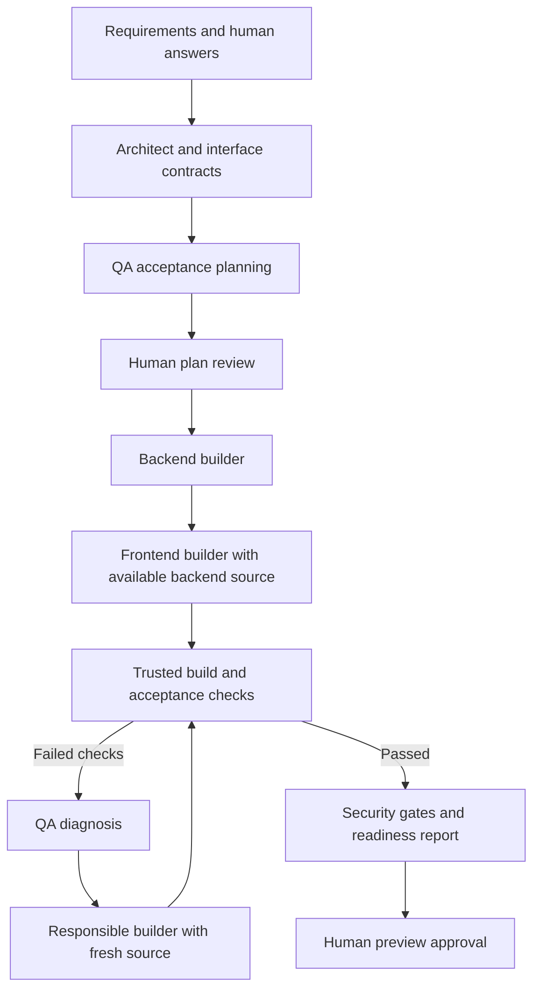

# Agent collaboration and focused repair

This phase keeps the installed Qwen2.5-Coder 7B model and improves how work is
delegated. The POC demonstrates coordinated roles with saved context and independent
checks, rather than an unrestricted autonomous full-stack developer.

## How the roles communicate

Requirements, Architect, QA and builders are separate prompted roles using the same
local model. Planning uses a checkpointed LangGraph; implementation delegates to a
compiled builder subgraph. The controller supplies structured inputs between roles.
They do not need free-form conversations or simultaneous model instances to cooperate.

The original request and human answers survive in the planning checkpoint. Reviewed
requirements, interfaces, acceptance scenarios and approval fingerprints survive in
the event store. Builders read source written by earlier builders. Failures return
to QA; its diagnosis goes to the responsible owner. A repair never declares itself
successful: independent checks must run again. Two repair attempts remain the limit.

## Inspectable handoffs

New planning, build and repair calls record `AGENT_HANDOFF` events, pointing at local
JSON snapshots under `artifacts/handoffs/<job>/`. Each snapshot records the context
supplied at that boundary; an event includes its canonical SHA-256, source-file list
and explicit omissions. These records do not change a job's status or approve work.

The dashboard's **Agent handoffs** tab shows the sender, recipient, purpose and
source-file counts. **Inspect saved context** opens the snapshot through the existing
authenticated, artifact-bounded report API. These are structured inputs, not invented
chat messages or evidence that a model obeyed every instruction. Older runs are not
backfilled with conversations that were never recorded.

## Smaller, current repair inputs

The earlier generic repair path sent every file, silently truncated each at 5,000
characters and reused that snapshot after edits. It now uses a 14,000-character JSON
budget, complete contracts and whole source files. Oversized related files are
explicitly omitted. If the complete target cannot fit, the repair stops for review.

The target's `current_source` is separate from `reference_only_source`, and the prompt
explicitly requests only that target's replacement. The packet is rebuilt after each
edit, so a route repair sees the helper just changed by the preceding call. QA's
diagnosis is saved as `REPAIR_DIAGNOSIS` and passed into a later attempt with the new
test failure. Failure output is bounded separately; all failing check names remain.
The same dependency preflight used in generation rejects unsupported repair imports
before writing the target. This is a limited import check, not a TypeScript parser.

## Evaluation

`python scripts/evaluate_handoff_repair.py` exercises the actual installed 7B model
through the generic repair path. It uses a deliberately broken calculator helper,
a fixed caller, and independent compiler/behavior checks. Generated code runs only
in a network-disabled, resource-limited Docker container. Its separate event database
never approves a user application, resets existing repair budgets or grants preview
permission. Evidence lives under `artifacts/handoff-evaluation/`.

The first trial diagnosed the wrong divisor correctly, but its builder concatenated
the helper, route and page. Import preflight rejected the output before it was written.
That trial is retained in `1c4063812f734ff6ab88464873dcc16e/result.json`. The more
explicit target/reference split was introduced in response and evaluated separately.

The follow-up trial, `2d132f8bf9484429971a4348176d41e9/result.json`, passed after
one repair attempt (QA selected the helper and its route, yielding two builder
calls). The independent compiler and ten behavior assertions passed without a
developer source correction. Both trials remain available; one synthetic success
is not a measured completion rate across generated applications.

The full regression run passed 116 tests. After the focused target/reference split,
the affected handoff, repair and workflow tests passed again (15 tests). The
dashboard TypeScript check and production build also passed.

The dashboard was exercised with a real 7B temperature-converter planning run,
`4b3fd81eb76f4be19780ef9a1b98d156`. Requirements reached the Architect, and the
Architect's proposed interfaces plus the original request reached QA. Both saved
packets remained inspectable after a page refresh. Reviewer corrections removed an
unrequested GET endpoint, fixed null/missing-field fixtures, accurately named the
JSON string probe, and removed unspecified error-message assertions. The original
proposal remains recorded; this was not an autonomous flawless plan.

The revised two-file plan reached `PLAN_REVIEW`, fingerprint
`ae84c6dc7604d0322ca266ab671a0481393c57b87e2a4a08e9f13b233d86862d`.
The user's subsequent instruction to continue authorized this reviewed build.
Its generation/recovery and verification evidence is documented in
`docs/converter-milestone.md`. Preview remains a separate approval.

Regression checks cover immutable handoff snapshots, current cross-file repair
context, diagnosis retention, ownership restrictions, unsupported imports and the
unchanged two-attempt bound. These checks establish controller behavior, not broad
model competence. Source checks and limited context records also do not provide
automatic force-crash recovery for every generation stage.

## Next steps

The converter now supplies a small end-to-end example: reviewed planning,
backend/frontend context sharing, one compiler-driven repair, one manually observed
browser defect sent through QA, and final passing scoped checks. See the converter
milestone for source-bound evidence and disclosures. Next, add automated browser
acceptance and GitHub CI. Remote database/cloud deployment remains
later scope. Keep prompts and fixtures small; expand supported app scope only when
measured results justify it.
